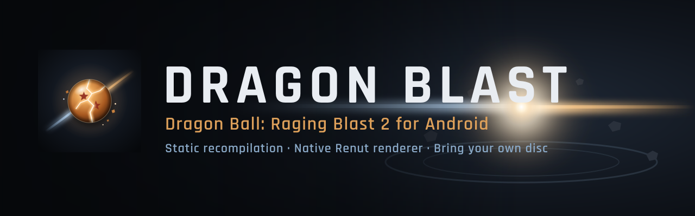

  

  
  
  
  
  
  

  
  

  <a href="#português">Português</a> · <a href="#english">English</a> · <a href="#español">Español</a>

---

## Português

**Dragon Blast** é um port nativo de **Dragon Ball: Raging Blast 2** (Xbox 360) para Android. O código PowerPC do jogo
foi recompilado antecipadamente para ARM64 e roda direto no aparelho, sem emulador, sobre o runtime ReXGlue e Vulkan.

> **Nenhum arquivo do jogo vem junto.** Você precisa da sua própria cópia, obtida legalmente, do disco de Xbox 360
> **USA Rev 1**. O app lê a sua ISO no aparelho e nada é enviado para a internet.

### Como jogar
1. Baixe o **[DragonBlast.apk](https://github.com/dfdx047/DragonBlast/releases/latest/download/DragonBlast.apk)** e
   instale (permita instalar pelo navegador ou gerenciador de arquivos).
2. Faça a imagem `.iso` do **seu** disco de Raging Blast 2 (Xbox 360, USA, Rev 1) e coloque-a no aparelho.
3. Abra o app e toque em **Importar ISO**. O app extrai e confere os arquivos (cerca de 5,4 GB); depois você pode
   apagar a `.iso`.
4. Toque em **Jogar**.

Atualizações: o app procura versões novas sozinho (ou em **Mais → Sobre → Procurar atualização**). A versão nova
instala por cima e mantém o jogo, os saves e as configurações.

### O que tem
- **Dois renderizadores:** o Renut, renderizador Direct3D nativo e o padrão, e o Xenia como alternativa.
- **Imagem:** resolução de 360p a 4K, filtros bilinear, FSR 1 e CAS, bloom e sombras ajustáveis, tela 16:9 ou
  esticada.
- **Controles na tela** com três esquemas de luta (Raging Blast, Moderno e Tenkaichi 3), layouts Pro, Normal e Casual,
  editor e troca automática entre menu e luta. Controles físicos funcionam direto.
- **Menu dentro do jogo** com gráficos, controles e FPS ao vivo.
- **Drivers de GPU:** baixe Turnip (Adreno) ou PanVK (Mali) de várias fontes do GitHub, ou importe um `.zip`.
- **Launcher em português, inglês e espanhol**, com explicação em cada opção.

### Requisitos e aparelhos
Android 10 ou mais novo, ARM64, Vulkan e cerca de 6 GB livres além da ISO. O mesmo APK traz um motor para CPUs
Armv8.2 e outro para Armv8.0 (por exemplo Snapdragon 665), e escolhe sozinho.

| Aparelho | Chip / GPU | Luta CPU × CPU |
|---|---|---|
| Poco X6 Pro | Dimensity 8300 / Mali-G615 | 55–57 FPS em qualquer resolução |
| Anbernic RG Cube | Unisoc T820 / Mali-G57 | 57 FPS a 360p (Leve), 45 a 480p, 40 a 720p |
| Xiaomi Mi A3 | Snapdragon 665 / Adreno 610 | 55–59 FPS a 360p frio, ~40 quente. **Baixe um Turnip** na aba Drivers (o driver do sistema não roda o Renut) |

Aparelhos fracos começam em 360p com bloom e sombras desligados. Desligue a economia de bateria e mantenha o aparelho
fresco: celulares sem ventoinha esquentam e perdem desempenho depois de alguns minutos.

---

## English

**Dragon Blast** is a native Android port of **Dragon Ball: Raging Blast 2** (Xbox 360). The game's PowerPC code is
recompiled ahead of time to ARM64 and runs directly on the device, with no emulator, on the ReXGlue runtime over Vulkan.

> **No game files are included.** You need your own legally obtained copy of the Xbox 360 disc, **USA Rev 1**. The app
> reads your ISO on the device and nothing is uploaded.

### How to play
1. Download **[DragonBlast.apk](https://github.com/dfdx047/DragonBlast/releases/latest/download/DragonBlast.apk)** and
   install it (allow installing from your browser or file manager).
2. Make a `.iso` image of **your** Raging Blast 2 disc (Xbox 360, USA, Rev 1) and put it on the device.
3. Open the app and tap **Import ISO**. It extracts and checks the files (about 5.4 GB); you can delete the `.iso`
   afterwards.
4. Tap **Play**.

Updates: the app looks for new versions itself (or **More → About → Check for updates**). A new version installs over
the old one and keeps the game, saves and settings.

### Features
- **Two renderers:** Renut, a native Direct3D renderer and the default, and Xenia as an alternative.
- **Picture:** 360p to 4K, bilinear, FSR 1 and CAS filters, bloom and shadows toggles, 16:9 or stretched.
- **Touch controls** with three fight schemes (Raging Blast, Modern and Tenkaichi 3), Pro, Normal and Casual layouts,
  an editor, and automatic switching between menus and fights. Physical controllers work out of the box.
- **In-game menu** with live graphics, controls and an FPS counter.
- **GPU drivers:** download Turnip (Adreno) or PanVK (Mali) from several GitHub sources, or import a `.zip`.
- **Launcher in English, Portuguese and Spanish**, with an explanation for every option.

### Requirements and devices
Android 10 or newer, ARM64, Vulkan and about 6 GB free besides the ISO. The same APK carries an engine for Armv8.2
CPUs and one for Armv8.0 (e.g. Snapdragon 665), and picks the right one by itself.

| Device | Chip / GPU | CPU vs CPU fight |
|---|---|---|
| Poco X6 Pro | Dimensity 8300 / Mali-G615 | 55–57 FPS at any resolution |
| Anbernic RG Cube | Unisoc T820 / Mali-G57 | 57 FPS at 360p (Light), 45 at 480p, 40 at 720p |
| Xiaomi Mi A3 | Snapdragon 665 / Adreno 610 | 55–59 FPS at 360p cold, ~40 warm. **Download a Turnip** in the Drivers tab (the stock driver cannot run Renut) |

Weak devices start at 360p with bloom and shadows off. Turn battery saver off and keep the device cool: phones without
a fan heat up and slow down after a few minutes.

---

## Español

**Dragon Blast** es un port nativo de **Dragon Ball: Raging Blast 2** (Xbox 360) para Android. El código PowerPC del
juego se recompila de antemano a ARM64 y corre directamente en el dispositivo, sin emulador, sobre el runtime ReXGlue y
Vulkan.

> **No incluye archivos del juego.** Necesitas tu propia copia, obtenida legalmente, del disco de Xbox 360
> **USA Rev 1**. La app lee tu ISO en el dispositivo y no se sube nada.

### Cómo jugar
1. Descarga **[DragonBlast.apk](https://github.com/dfdx047/DragonBlast/releases/latest/download/DragonBlast.apk)** e
   instálalo (permite instalar desde el navegador o el gestor de archivos).
2. Crea la imagen `.iso` de **tu** disco de Raging Blast 2 (Xbox 360, USA, Rev 1) y ponla en el dispositivo.
3. Abre la app y toca **Importar ISO**. La app extrae y comprueba los archivos (unos 5,4 GB); después puedes borrar la
   `.iso`.
4. Toca **Jugar**.

Actualizaciones: la app busca versiones nuevas sola (o en **Más → Acerca de → Buscar actualización**). La versión nueva
se instala encima y mantiene el juego, las partidas y los ajustes.

### Qué incluye
- **Dos renderizadores:** Renut, renderizador Direct3D nativo y el predeterminado, y Xenia como alternativa.
- **Imagen:** de 360p a 4K, filtros bilineal, FSR 1 y CAS, bloom y sombras ajustables, 16:9 o estirada.
- **Controles táctiles** con tres esquemas de pelea (Raging Blast, Moderno y Tenkaichi 3), diseños Pro, Normal y
  Casual, editor y cambio automático entre menú y pelea. Los mandos físicos funcionan directamente.
- **Menú dentro del juego** con gráficos, controles y FPS en vivo.
- **Drivers de GPU:** descarga Turnip (Adreno) o PanVK (Mali) de varias fuentes de GitHub, o importa un `.zip`.
- **Launcher en español, portugués e inglés**, con explicación en cada opción.

### Requisitos y dispositivos
Android 10 o superior, ARM64, Vulkan y unos 6 GB libres además de la ISO. El mismo APK trae un motor para CPUs Armv8.2
y otro para Armv8.0 (por ejemplo Snapdragon 665), y elige solo.

| Dispositivo | Chip / GPU | Pelea CPU vs CPU |
|---|---|---|
| Poco X6 Pro | Dimensity 8300 / Mali-G615 | 55–57 FPS en cualquier resolución |
| Anbernic RG Cube | Unisoc T820 / Mali-G57 | 57 FPS a 360p (Ligero), 45 a 480p, 40 a 720p |
| Xiaomi Mi A3 | Snapdragon 665 / Adreno 610 | 55–59 FPS a 360p en frío, ~40 caliente. **Descarga un Turnip** en la pestaña Drivers (el driver del sistema no corre Renut) |

Los dispositivos débiles empiezan en 360p con bloom y sombras apagados. Apaga el ahorro de batería y mantén el
dispositivo fresco: los móviles sin ventilador se calientan y bajan el rendimiento tras unos minutos.

---

## Credits · Créditos

| | |
|---|---|
| [WistfulHopes — RB2 Recompiled](https://github.com/WistfulHopes/RB2) | The Raging Blast 2 recompilation this port is built on |
| [moddedrounds — RB2-Android](https://github.com/moddedrounds/RB2-Android) | The first Android port, which Dragon Blast forks |
| [ReXGlue SDK](https://github.com/rexglue/rexglue-sdk) · [REBlue](https://github.com/rexglue/reblue) | Xbox 360 recompiler and runtime; dlmalloc setup |
| [Xenia](https://github.com/xenia-project/xenia) | Xbox 360 GPU emulation the runtime comes from |
| **Renut**: reNut (masterspike52) → banjo-nx → sa2-nx → [mgr-nx-deko](https://github.com/tuancapoo/mgr-nx-deko) (tuancapoo) → [Zandatsu](https://github.com/dfdx047/Zandatsu) → Dragon Burst | Native Direct3D renderer, used with its authors' permission, with credit and open source |
| [Project8Recomp](https://github.com/theokyr/Project8Recomp) | Android runtime and SDK patches shared with RB2-Android |
| [SDL](https://libsdl.org) | Window, controllers and audio |
| [Mesa](https://mesa3d.org) (Turnip, PanVK) · [libadrenotools](https://github.com/bylaws/libadrenotools) | Open Vulkan drivers and the loader for custom drivers |
| Mr. Purple · StevenMXZ · K11MCH1 · whitebelyash · faux123 · ARMSX2 | Turnip builds offered in the Drivers tab |
| zenithblue · JimVulkan · FristOneRR · MineGraph · MaliSX2 (ARMSX2) | PanVK and Mali driver builds offered in the Drivers tab |
| [AMD FidelityFX](https://github.com/GPUOpen-Effects/FidelityFX-FSR) | FSR 1 and CAS (MIT) |
| [dlmalloc](https://gee.cs.oswego.edu/dl/html/malloc.html) | Heap allocator |
| [Rajdhani](https://fonts.google.com/specimen/Rajdhani) (Indian Type Foundry) | Launcher font (OFL) |

Android port, launcher, controls and art: **DFD ([dfdx047](https://github.com/dfdx047))**.

## License · Licença · Licencia

The RB2 recompilation code is BSD-3-Clause ([`LICENSE`](LICENSE)). The Renut parts (`patches/renut/`,
`android/native/src/renut/`, `tools/renut/`) derive from mgr-nx-deko and are GPL-3.0
([`LICENSE-GPL-3.0`](LICENSE-GPL-3.0)); the APK, which includes the Renut, is GPL-3.0 as a whole.

## Legal

This repository and the APK contain **no game data**: no disc image, `default.xex`, textures, models, sounds or movies.
The recompiled game code inside the APK is encrypted with a key derived from the player's own `default.xex`, so it
only runs after you import your own disc. Requests for game files or ISOs will be closed without reply.

Dragon Ball and Raging Blast are trademarks of their respective owners. This project is not affiliated with or
endorsed by them. The icons, artwork and animations here are original.

Building it yourself: [`docs/BUILDING.md`](docs/BUILDING.md).
